## 01 / POWER-UPS · LANGUAGE MIX

## 02 / FLIGHT LOG · CONTRIBUTION ACTIVITY

## 03 / MISSIONS · BY STARS

---

SIGNAL RUN · the cards above are generated daily from live GitHub data by this repo's own pipeline — no third-party services, no watermarks · see <a href="https://github.com/jontstaz/jontstaz/blob/main/.github/PIPELINE.md">PIPELINE.md</a>

