# Jonte de Zwart · `jontstaz`

**DevSecOps Engineer at [Tesserent (Thales)](https://www.tesserent.com) · Melbourne, Australia**

I secure and automate cloud infrastructure by day — Terraform, SaltStack, OPA/Rego across a fleet of 150+ servers — and build AI tooling, agentic workflows and trading systems by night. Ex-[Binance](https://binance.com) API Solutions Engineering, ex-[Deloitte](https://www.deloitte.com) Cloud Security. Shipping constantly across AI agents, ComfyUI/RunPod tooling, trading bots and web apps.

---

## 01 / FEATURED BUILDS

The full set lives at **[jonte.au/projects](https://jonte.au/projects)** — these are the ones I'd want you to see first:

| | Project | What it does |
|---|---|---|
| ☎️ | **[Ringmate](https://github.com/jontstaz/ringmate)** | AI phone receptionist for Australian tradies — answers missed calls on-site, qualifies jobs, quotes call-out rates, books calendar slots in real time. `TypeScript` `Gemini Live API` `Twilio Voice` |
| 🎛️ | **[PodBench](https://github.com/jontstaz/podbench)** | Personal ComfyUI workflow library + ephemeral RunPod GPU pod launcher — kills idle VRAM billing and manual custom-node provisioning. `TypeScript` `RunPod GraphQL` `Docker` |
| 🐳 | **[AI Dockerfile + Compose Generator](https://github.com/jontstaz/ai-docker-generator)** | AST-aware containerisation tool — inspects repo lockfiles and entrypoints, emits hardened non-root multi-stage Dockerfiles. ★ 72. `TypeScript` `BuildKit` `Trivy` |
| 🔖 | **[Linkding ObsidianMD Sync](https://github.com/jontstaz/obsidian-linkding-sync)** | Bi-directional sync between self-hosted Linkding bookmarks and Obsidian vaults, with frontmatter tag hydration. `TypeScript` `Markdown AST` |
| 🧠 | **[ai-job-search](https://github.com/jontstaz/ai-job-search)** | Role ingestion → requirement extraction → evidence-grounded CV tailoring, with zero hallucinated experience claims. `Python` `Structured Outputs` |
| 📈 | **[Prediction-market arb engine](https://github.com/jontstaz/prediction-arb-engine)** | Cross-venue orderbook monitor + delta-neutral execution for mispriced contracts across Polymarket CLOB and Kalshi. `Python` `AsyncIO` `WebSockets` |

Older builds — BSC token sniper (★ 89), PancakeSwap prediction bot, and more — are on [jonte.au/projects](https://jonte.au/projects) too.

## 02 / POWER-UPS · LANGUAGE MIX

## 03 / FLIGHT LOG · CONTRIBUTION ACTIVITY

## 04 / MISSIONS · BY STARS

---

### WHERE TO FIND ME

SIGNAL RUN · the five cards above are generated daily from live GitHub data by this repo's own pipeline — no third-party services, no watermarks · see <a href="https://github.com/jontstaz/jontstaz/blob/main/.github/PIPELINE.md">PIPELINE.md</a>

