<div align="center">

<a href="https://github.com/jontstaz"></a>

</div>

```bash
$ whoami
```

<div align="center">

<a href="https://github.com/jontstaz"></a>

</div>

I'm a software engineer and builder focused on **AI-powered developer tools, automation, infrastructure, and self-hosted systems**.

I enjoy taking ideas from prototype to production — building full-stack applications, agentic workflows, APIs, integrations, and the infrastructure behind them.

<sub>NOW EXPLORING · Agentic development / Local AI / Developer experience / Automation</sub>

## <sub>01 / MISSIONS · FEATURED BUILDS</sub>

<div align="center">

<a href="https://github.com/jontstaz?tab=repositories&sort=stargazers"></a>

</div>

## <sub>02 / POWER-UPS · LANGUAGE MIX</sub>

<div align="center">


</div>

## <sub>03 / FLIGHT LOG · CONTRIBUTION ACTIVITY</sub>

<div align="center">



</div>

---

<div align="center">

**[GitHub](https://github.com/jontstaz) · [Website](https://jonte.au) · [X](https://x.com/Jonte_z)**

<sub>SIGNAL RUN · generated daily from live GitHub data · no third-party services</sub>

</div>
